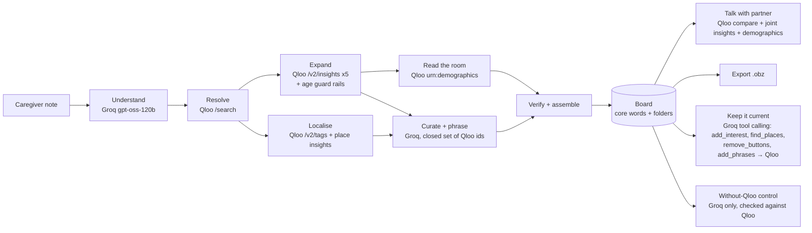

# Fringe: the words for what they love

**Live demo:** https://fringe-aac.vercel.app · **Built for the** [Qloo Agentic Hackathon](https://qloo.devpost.com) · **License:** MIT

Fringe is an AI agent that builds personal **AAC** (augmentative and alternative communication) boards from **Qloo's taste graph**. It gives people who can't rely on speech the words for the shows, songs, games, books, foods and places they love, so they can do what most talk is for: connect with people.

> One sentence from a parent or speech therapist ("loves Bluey, Taylor Swift, Encanto, Minecraft, mac and cheese") becomes a working, talking board of about 50 picture buttons in roughly 10 seconds. Every button traces back to a Qloo entity or the caregiver's own words.

---

## The problem

- About **4 million Americans** can't reliably meet daily communication needs with natural speech (Beukelman & Mirenda, cited by the National Academies, 2017). Many speak through AAC: tablets and picture boards that turn a tap into a voice.
- Those boards are built around **needs**: *eat, drink, toilet, pain*. But adults rank **social closeness** as their first reason to communicate (Light's purposes of communicative interaction), and closeness runs on *fringe vocabulary*: the personal words for a favourite show, a band, a team or a local place.
- Today, fringe vocabulary is added **by hand**, one button at a time, by a parent or a speech-language pathologist (SLP) with a full caseload. It goes stale as soon as tastes change.

An AAC board without culture is *technically functional*. A board that knows what someone loves is how they make friends. That gap is the one this hackathon asks about.

## What Fringe does

| | |
|---|---|
| **Builds the board** | Turns a one-line note into topic folders (Shows, Movies, Music, Games, Books, Places, Food) with real pictures, natural first-person phrases and social-closeness phrases ("Have you seen it?"). |
| **Keeps core words fixed** | The 16 high-frequency core words stay in fixed positions, colour-coded with the Modified Fitzgerald Key, so motor plans never break. Personal vocabulary lives in folders. |
| **Reads the room** | Uses Qloo demographics to label who each topic will land with: Bluey is a *parents & teachers* topic, Sinatra a *grandkids* one. |
| **Keeps it current** | Tastes change. A caregiver types *"she's obsessed with dinosaurs now, find somewhere she can swim, remove Hello Neighbor, it scares her"*. A **tool-calling agent** plans and runs Qloo-backed tools: a dinosaur tag as a hard filter ranked by *her* taste (The Land Before Time, not Jurassic Park), swimming pools in Austin, and a removal. |
| **Fits how they access it** | "Large targets" mode gives eye-gaze, switch and motor-access users fewer, bigger buttons. |
| **Talk with someone** | Builds a page for one conversation partner (Grandpa Joe, a new lab partner). It compares the two taste profiles, searches with both as the signal, and keeps topics with positive affinity in **both** people's age groups. |
| **Shows its evidence** | Every button has a "why": affinity score, source, age groups, address, Qloo entity id. The agent's steps stream live into the studio. |
| **Human in the loop** | Favourites the caregiver named go straight in. Every agent suggestion waits for a parent or SLP to keep or remove it. |
| **No lock-in** | Exports to **Open Board Format** (`.obz`), the open interchange format for AAC boards. |
| **Proves Qloo matters** | A live "Without Qloo" experiment runs the same model with no taste graph and checks every suggestion against Qloo. |
| **Private by default** | No account. Boards live in the browser; the server stores no personal data. |

## Why it needs Qloo

The language model handles **language**: parsing the caregiver's note and phrasing buttons. **Qloo decides what goes on the board.** The curation step may only choose from ids Qloo returned, and a verifier drops anything else.

Running the LLM-only control on Maya's note produced mostly restatements of the note (9 of 12 items), plus events that can't be verified ("Mac and Cheese Cooking Class for Kids at Central Market"). It produced no pictures, no checkable places and no audience signal. Qloo supplies the parts an AAC button actually needs:

| Qloo capability | Endpoint | What it does in Fringe |
|---|---|---|
| Entity search | `GET /search` | Resolves each favourite to a canonical entity and a **picture** for the button. A pre-literate child or a person with aphasia navigates by image. |
| Cross-domain insights | `GET /v2/insights` × 5 (`tv_show`, `movie`, `artist`, `videogame`, `book`) | Expands taste across domains. Age guard rails use `filter.content_rating` (G/PG, TV-Y…TV-PG) and children's book tags. Self-corrects with a popularity floor when a filter is too tight. |
| Tags | `GET /v2/tags` | Turns a food ("deep dish pizza") into a dish or cuisine tag (`menu_highlight`, `specialty_dish`) to find where to eat it. |
| Location insights | `GET /v2/insights` (`place`, `filter.location.query`, `filter.tags`) | Real places in the person's city that people with this taste over-index on, filtered for kid-friendliness. |
| Demographics | `GET /v2/insights` (`urn:demographics`) | Age-group affinity for each topic, which drives "who it lands with" and the bridge scoring. |
| Compare | `GET /v2/analysis/compare` | The taste themes two people share ("Country, Blues, Folk, Comedy, Family"). |
| Tag-filtered insights | `GET /v2/insights` with `filter.tags` + taste signal | "Dinosaurs" for *Maya* means The Land Before Time and *We're Back! A Dinosaur's Story*, not just Jurassic Park. |
| Joint signal | `GET /v2/insights` with both profiles | Candidate topics for a conversation partner, re-ranked by positive affinity in **both** age groups. |

## Architecture



- **Next.js 16** (App Router, TypeScript) on Vercel. Agent runs stream as NDJSON, so the studio shows every step live.
- **Qloo client** (`src/lib/qloo.ts`): typed wrapper with stable cache keys, an in-memory TTL cache with in-flight de-duplication, timeouts, retry on 429/5xx, and response trimming (`akas` and other verbose fields never reach the LLM).
- **LLM** (`src/lib/llm.ts`): Groq's OpenAI-compatible API in JSON mode. Falls through `gpt-oss-120b` → `gpt-oss-20b` → `qwen3.8-27b` on rate limits. Every LLM step has a deterministic fallback, so the demo never dead-ends.
- **Refine agent** (`src/lib/refine.ts`): a bounded tool-calling loop (Groq function calling, up to 4 turns). The model plans; each tool hits Qloo and reports back, so the model can react. The reply shown to the user is built from what the tools actually did, never from the model's own claims.
- **Agent** (`src/lib/agent.ts`, `src/lib/bridge.ts`): explicit steps with self-correction (widening a search when a name resolves to a non-boardable type, relaxing a too-strict rating filter, trying progressively broader food tags). Candidates go to the LLM under short handles rather than UUIDs, which saves tokens and prevents mangled ids.
- **Device UI** (`src/components/Device.tsx`): sentence strip, Web Speech output, Fitzgerald-coded core words, picture folders, caregiver review mode.
- **OBF export** (`src/lib/obf.ts`): root board with fixed core words, linked to one sub-board per folder.

## Run it locally

```bash
git clone https://github.com/Arnav020/fringe && cd fringe
npm install
cp .env.example .env.local   # add QLOO_API_KEY (hackathon key) and GROQ_API_KEY
npm run dev                  # http://localhost:3000
```

- `QLOO_API_KEY`: a Qloo hackathon key. The client calls `https://hackathon.api.qloo.com` with the `X-Api-Key` header.
- `GROQ_API_KEY`: a free key from console.groq.com.

No Qloo response data is committed to this repository. All Qloo data is fetched live and cached only in server memory.

## Try it as a judge

1. Open **https://fringe-aac.vercel.app/studio?p=maya**. The agent builds Maya's board live; watch the steps on the right.
2. Tap pictures and core words to hear them spoken and build a sentence. Tap the **info** button on any picture for its Qloo evidence.
3. Open **Talk with Grandpa Joe** → build. You get the shared themes, both age groups' affinity bars, and a new folder on the board.
4. Open **Without Qloo** → run the LLM-only control and compare.
5. In **"Tastes change"**, tap *"She's obsessed with dinosaurs now"* and watch the tool-calling agent update the board.
6. Turn on **Caregiver review**, keep or remove suggestions, then **Export (.obz)**.
7. Try **Leo** (16, eye-gaze user, Chicago) and **Ruth** (71, aphasia, Boston), or build your own.

## Responsible design

- Fringe is a vocabulary tool, not a medical device. Boards are reviewed by the people who know the user.
- Personas are illustrative, not real individuals.
- Kids' boards use content-rating filters, and the curator is told to skip anything inappropriate for the person's age.
- No accounts and no analytics. Board data stays in the user's browser.

## License

[MIT](LICENSE) © 2026 Arnav Joshi. Taste data by Qloo Taste AI™.
