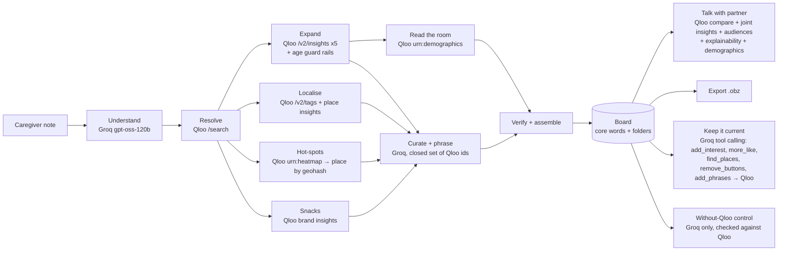

# Fringe: the words for what they love

**Live demo:** https://fringe-aac.vercel.app · **Built for the** [Qloo Agentic Hackathon](https://qloo.devpost.com) · **License:** MIT

Fringe is an AI agent that builds personal **AAC** (augmentative and alternative communication) boards from **Qloo's taste graph**. It gives people who can't rely on speech the words for the shows, songs, games, books, foods and places they love, so they can do what most talk is for: connect with people.

> One sentence from a parent or speech therapist ("loves Bluey, Taylor Swift, Encanto, Minecraft, mac and cheese") becomes a working, talking board of about 50 picture buttons in roughly 10 seconds. Every button traces back to a Qloo entity or the caregiver's own words.

---

## The problem

- About **4 million Americans** can't reliably meet daily communication needs with natural speech (Beukelman & Mirenda, cited by the National Academies, 2017). Many speak through AAC: tablets and picture boards that turn a tap into a voice.
- Those boards are built around **needs**: *eat, drink, toilet, pain*. But adults rank **social closeness** as their first reason to communicate (Light's purposes of communicative interaction), and closeness runs on *fringe vocabulary*: the personal words for a favourite show, a band, a team or a local place.
- Today, fringe vocabulary is added **by hand**, one button at a time, by a parent or a speech-language pathologist (SLP) with a full caseload. It goes stale as soon as tastes change.
- That staleness is a known cause of abandonment. In a survey of 275 AAC specialists, **not maintaining or adjusting the system** and **poor fit** were among the factors most often linked to people giving up on AAC (Johnson, Inglebret, Jones & Ray, *AAC* 22(2), 2006).
- About **30% of autistic children remain minimally verbal** even after years of intervention (Tager-Flusberg & Kasari, *Autism Research*, 2013). And AAC doesn't stop speech: in a review of 27 cases, none spoke less and 89% spoke more (Millar, Light & Schlosser, *JSLHR*, 2006).
- And the fit is cultural. A review of research on culturally and linguistically diverse AAC users found AAC practice is shaped by Western, Euro-American norms (Kulkarni & Parmar, *AAC* 33, 2017). Speech therapists have asked the open-source AAC app Cboard for country-specific tiles since 2022 ([cboard#1267](https://github.com/cboard-org/cboard/issues/1267)): *alfajores* in Argentina, *queque* in Chile.

An AAC board without culture is *technically functional*. A board that knows what someone loves is how they make friends. That gap is the one this hackathon asks about.

## What Fringe does

| | |
|---|---|
| **Builds the board** | Turns a one-line note into topic folders (Shows, Movies, Music, Games, Books, People, Places, Food) with real pictures, natural first-person phrases and social-closeness phrases ("Have you seen it?"). |
| **Keeps core words fixed** | 24 high-frequency core words, each with a symbol, stay in fixed positions, colour-coded with the Modified Fitzgerald Key, so motor plans never break. *Help*, *stop* and *all done* are always there. Personal vocabulary lives in folders. |
| **Explains every pick** | Qloo explainability says which of the person's favourites led to each suggestion: *Wings of Fire* because she loves Bluey (35%) and Minecraft (30%). |
| **Knows where their taste lives** | A Qloo heatmap of their city shows where people with their taste concentrate. Places come from inside those hot-spots (parks, pools, museums for kids), and the studio draws the map with the board's places pinned on it. |
| **Speaks the family's language** | Aarav's family speaks Hindi: one switch turns every core word and phrase into Hindi, spoken with a Hindi voice, using Qloo's own localised names where it has them. |
| **Reads the room** | Uses Qloo demographics to label who each topic will land with: Bluey is a *parents & teachers* topic, Sinatra a *grandkids* one. |
| **Keeps it current** | Tastes change. A caregiver types *"she's obsessed with dinosaurs now, find somewhere she can swim, remove Hello Neighbor, it scares her"*. A **tool-calling agent** plans and runs Qloo-backed tools: a dinosaur tag as a hard filter ranked by *her* taste (The Land Before Time, not Jurassic Park), swimming pools in Austin, and a removal. It also **learns from use**: taps are counted on the device, and "more like what she taps" sends the most-tapped buttons to Qloo as the signal. |
| **Fits how they access it** | "Large targets" mode gives eye-gaze, switch and motor-access users fewer, bigger buttons. |
| **Lets them choose** | Many AAC users can't tell anyone what they like, and a caregiver's note only lists what's already known. **This or that** is a paired-choice preference session: two pictures at a time from Qloo, one "more like what they just picked", one from a different domain of their taste. The next pair follows what they reached for, and the picks go onto the board as favourites *they* chose, then steer more suggestions. |
| **Talk with someone** | Builds a page for one conversation partner (Grandpa Joe, a new lab partner). It compares the two taste profiles, searches with both as the signal (adding Qloo's retirement audience when one of them is 60+), keeps topics with positive affinity in **both** people's age groups, and uses explainability to prefer topics that draw on **both** people's favourites: *The Waltons* draws 55% on Maya's and 45% on Grandpa Joe's. |
| **Shows its evidence** | Every button has a "why": affinity score, source, age groups, address, Qloo entity id. The agent's steps stream live into the studio. |
| **Human in the loop** | Favourites the caregiver named go straight in. Every agent suggestion waits for a parent or SLP to keep or remove it. |
| **No lock-in** | Exports to **Open Board Format** (`.obz`), the open interchange format for AAC boards. |
| **Proves Qloo matters** | A live "Without Qloo" experiment runs the same model with no taste graph and checks every suggestion against Qloo. |
| **Private by default** | No account. Boards live in the browser; the server stores no personal data. |

## Why it needs Qloo

The language model handles **language**: parsing the caregiver's note and phrasing buttons. **Qloo decides what goes on the board.** The curation step may only choose from ids Qloo returned, and a verifier drops anything else.

Running the LLM-only control on Maya's note produced mostly restatements of the note (9 of 12 items), plus events that can't be verified ("Mac and Cheese Cooking Class for Kids at Central Market"). It produced no pictures, no checkable places and no audience signal. Qloo supplies the parts an AAC button actually needs:

| Qloo capability | Endpoint / parameter | What it does in Fringe |
|---|---|---|
| Entity search | `GET /search` | Resolves each favourite to a canonical entity and a **picture** for the button. A pre-literate child or a person with aphasia navigates by image. |
| Cross-domain insights | `GET /v2/insights` × 6 (`tv_show`, `movie`, `artist`, `videogame`, `book`, `person`) | Expands taste across domains. Age guard rails use `filter.content_rating` for film and TV, children's book tags, and the ESRB rating Qloo stores on each game. Self-corrects with a popularity floor when a filter is too tight. |
| Explainability | `feature.explainability=true` | Which of the person's favourites drove each pick, shown as bars on every button and in the bridge ("55% Maya's favourites, 45% Grandpa's"). |
| Heatmap | `urn:heatmap` + `output.heatmap.boundary=urn:geohash` | Where in their city people with this taste concentrate. The two strongest areas become hot-spots, drawn on a map in the studio. |
| Places by geohash and category | `urn:entity:place` + `filter.location.geohash`, `filter.tags` with `operator.filter.tags=union` | Real places inside those hot-spots; for children only outing categories (parks, pools, museums, playgrounds, ice cream) via Qloo category tags. |
| Tags | `GET /v2/tags` | Turns a food ("deep dish pizza") into a dish or cuisine tag (`menu_highlight`, `specialty_dish`), and a theme ("dinosaurs") into a hard filter. |
| Brand insights | `urn:entity:brand` + `filter.tags=…food_and_beverage` + `signal.demographics.age` | Snacks and treats a person with this taste would ask for (Oreo, Doritos, Skittles), with coffee, alcohol and energy drinks removed for minors. |
| Demographics | `urn:demographics` | Age-group affinity for each topic, which drives "who it lands with" and the bridge scoring. |
| Compare | `GET /v2/analysis/compare` | The taste themes two people share ("Comedy, Family"). |
| Audiences | `signal.demographics.audiences=urn:audience:life_stage:retirement` | An extra bridge signal when the partner (or the AAC user) is 60+. |
| Localised names | `properties.akas` | Hindi (and other) names Qloo knows, used as labels when the board speaks the family's language. |
| Joint, tapped and chosen signals | `signal.interests.entities` | Both people's favourites for the bridge; the most-tapped buttons for "more like what she taps"; each "This or that" choice as the signal for the next pair. |

**What we tried and left out, on purpose.** `signal.demographics.age` on the main expansion pulled an Indian 12-year-old's board towards US youth titles (Kota Factory and Shreya Ghoshal gave way to The Crystal Maze), so age is handled by content ratings and demographics instead; the age signal is used only for snacks. `/v2/trending` in the hackathon snapshot ends in June 2026 and is flat week to week, so it can't say what is rising now; Fringe uses each entity's popularity percentile to show how widely known a topic is ("an easy opener with anyone") instead.

## Architecture



- **Next.js 16** (App Router, TypeScript) on Vercel. Agent runs stream as NDJSON, so the studio shows every step live.
- **Qloo client** (`src/lib/qloo.ts`): typed wrapper with stable cache keys, an in-memory TTL cache with in-flight de-duplication, timeouts, retry on 429/5xx, and response trimming (`akas` and other verbose fields never reach the LLM).
- **LLM** (`src/lib/llm.ts`): Groq's OpenAI-compatible API in JSON mode. Falls through `gpt-oss-120b` → `gpt-oss-20b` → `qwen3.8-27b` on rate limits. Every LLM step has a deterministic fallback, so the demo never dead-ends.
- **Refine agent** (`src/lib/refine.ts`): a bounded tool-calling loop (Groq function calling, up to 4 turns) with five tools, including `more_like`, which turns the buttons a person taps most into the Qloo signal. The model plans; each tool hits Qloo and reports back, so the model can react. The reply shown to the user is built from what the tools actually did, never from the model's own claims.
- **Agent** (`src/lib/agent.ts`, `src/lib/bridge.ts`): explicit steps with self-correction (widening a search when a name resolves to a non-boardable type, relaxing a too-strict rating filter, trying progressively broader food tags). Candidates go to the LLM under short handles rather than UUIDs, which saves tokens and prevents mangled ids.
- **Device UI** (`src/components/Device.tsx`): sentence strip, Web Speech output, Fitzgerald-coded core words, picture folders, caregiver review mode.
- **OBF export** (`src/lib/obf.ts`): root board with fixed core words, linked to one sub-board per folder.

## Use Fringe from your own agent (MCP)

Fringe is also an **MCP server** (Streamable HTTP, stateless), so an existing agent such as Claude, an AAC app's assistant or a care-coordination bot can give its users culturally grounded vocabulary:

```bash
claude mcp add --transport http fringe https://fringe-aac.vercel.app/api/mcp
```

| Tool | What it does |
|---|---|
| `build_aac_board(name, age, city, likes)` | Runs the full build agent and returns the board: a text summary for the model, plus the full board as `structuredContent`. |
| `talk_with_partner(..., partnerName, partnerAge, partnerLikes)` | Runs the bridge agent for a specific conversation partner. |

## Tests

```bash
npm test   # vitest, 26 tests: age guard rails (ESRB, film/TV ratings), name matching, fallback parsing and planning, place filters, curation handles, core vocabulary, Open Board Format export
```

Beyond unit tests, Fringe was stress-tested black-box against the live deployment with 55 scenarios written from this README: typos ("Bluee", "Tayler Swift"), notes with only themes or only foods, notes in Spanish, prompt injection, a child whose family names M-rated games, unknown cities, Lagos and Tokyo, ages 3 to 100, a 6,000-character note, abusive refine requests, and every MCP error path. Plus 16 browser tests (switching persona mid-build, double-clicking Build, reload, export, review queue, 375px mobile). Things it found and fixed:

- Qloo search isn't typo-tolerant: "Bluee" came back as *Blue Eye Samurai* (TV-MA). The model now corrects spelling and the resolver only accepts close name matches.
- Mixing a theme tag with entity signals derails results (Bluey + "dinosaurs" returned adult dramas), so themes are a filter alongside favourites and a signal only on their own.
- When the language model is rate-limited, every step still finishes: a plain parser, a rule-based planner for "Tastes change", phrase templates, and Hindi and Spanish phrase patterns.
- Favourites rated above the person's age (film, TV and game ratings from Qloo) stay on the board for the caregiver to review, but never steer suggestions.

## Run it locally

```bash
git clone https://github.com/Arnav020/fringe && cd fringe
npm install
cp .env.example .env.local   # add QLOO_API_KEY (hackathon key) and GROQ_API_KEY
npm run dev                  # http://localhost:3000
```

- `QLOO_API_KEY`: a Qloo hackathon key. The client calls `https://hackathon.api.qloo.com` with the `X-Api-Key` header.
- `GROQ_API_KEY`: a free key from console.groq.com.

No Qloo response data is committed to this repository. All Qloo data is fetched live and cached only in server memory.

## Try it as a judge

1. Open **https://fringe-aac.vercel.app/studio?p=maya**. The agent builds Maya's board live; watch the steps on the right.
2. Tap pictures and core words to hear them spoken and build a sentence. Tap the **info** button on any picture: Qloo affinity, which of Maya's favourites led to it (explainability), how widely known it is, and who it lands with.
3. Scroll the left column to **Where Maya's taste lives**: the Qloo heatmap of Austin with her places pinned on it.
4. Open **Talk with Grandpa Joe** → build. You get the shared themes, how much each topic draws on each person's favourites, both age groups' affinity bars, and a new folder on the board.
5. Open **This or that**: tap one of two pictures six times. The pairs follow her choices; then add the picks to the board.
6. Open **Without Qloo** → run the LLM-only control and compare.
7. In **"Tastes change"**, tap *"She's obsessed with dinosaurs now"* and watch the tool-calling agent update the board. After tapping a few pictures, a **"More like what Maya taps"** chip appears.
8. Turn on **Caregiver review**, keep or remove suggestions, then **Export (.obz)**.
9. Try **Aarav** (12, Mumbai): his board knows Chhota Bheem, Motu Patlu, Lagaan, Shreya Ghoshal and the cricket grounds near him. Turn on **Speak Hindi**. Then **Leo** (16, eye-gaze user, Chicago) and **Ruth** (71, aphasia, Boston), or build your own.

## Responsible design

- Fringe is a vocabulary tool, not a medical device. Boards are reviewed by the people who know the user.
- Personas are illustrative, not real individuals.
- Kids' boards use content-rating filters (and ESRB ratings for games), outing-only place categories, and a deterministic deny-list under the curation prompt for names a parent wouldn't expect on a child's board.
- Taps are counted only in the browser. Nothing is sent until a caregiver asks for "more like what she taps", and then only the button names.
- No accounts and no analytics. Board data stays in the user's browser.

## License

[MIT](LICENSE) © 2026 Arnav Joshi. Taste data by Qloo Taste AI™.
